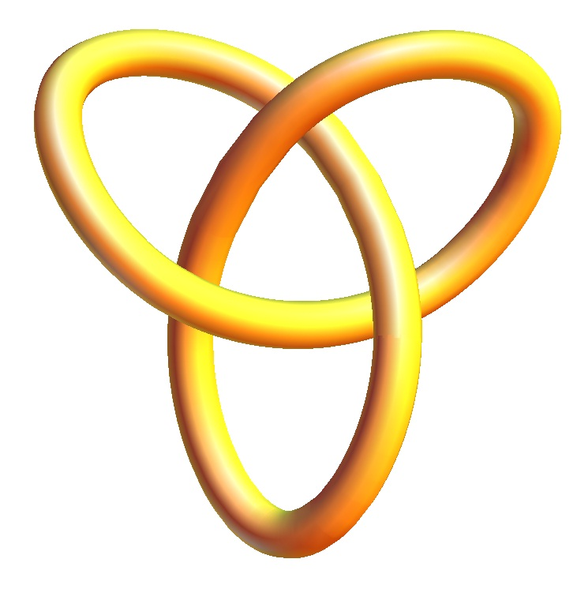

# Theorems and Proofs

A personal compendium of definitions, theorems, and proofs from my undergraduate mathematics coursework at Brigham Young University, typeset in LaTeX. It runs from Euclid's postulates through real analysis, linear algebra, number theory, and set theory, about 180 pages in its current form.

📄 **[Read the compiled PDF](Mathematical_Proofs.pdf)**

<p align="center">
  
</p>

## Why this exists

In a freshman math course, we were asked to keep a running record of the new and interesting results we learned. I was learning LaTeX at the same time, so I combined the two. I kept adding to it through the rest of my math classes, and it grew into a single reference document covering most of the undergraduate core.

It's a study notebook, not a textbook: some results are proved in full, some are stated with a proof sketch, and some proofs are still unfinished. Those are being completed over time — see [Status](#status).

## What's inside

| Part | Topics |
|---|---|
| **Geometry** | Euclid's postulates, area and volume formulas, quadric surfaces, the Pythagorean theorem, lines, planes, curvature, the Frenet frame |
| **Trigonometry** | The unit circle, identities derived from it, inverse trig functions |
| **Calculus** | Sequences and series, functional limits and continuity, uniform convergence, power and Taylor series, differentiation, the mean value theorems, L'Hôpital's rule, differential equations and the Laplace transform, the Riemann integral, an integral table, partial derivatives, multiple integrals, and vector calculus through Green's, Stokes', and the Divergence Theorem |
| **Linear Algebra** | Gauss–Jordan elimination, linear transformations, subspaces, bases and dimension, linear spaces, orthogonality and least squares, Gram–Schmidt and QR, determinants, eigenvalues, diagonalization, stability |
| **Number Theory** | Divisibility, the division algorithm, GCDs and the Euclidean algorithm, the Fundamental Theorem of Arithmetic, irrationality of √2 and *e*, the completeness axiom |
| **Set Theory** | Cardinality, countable and uncountable sets, Schröder–Bernstein, Cantor's theorem, topology of ℝ (open, closed, and compact sets, Heine–Borel) |
| **Additional Topics** | Sigma notation, Fibonacci numbers, Pascal's triangle, Euclid's infinitude of primes, Faulhaber's formula, Gabriel's horn, the Cantor set |

Figures include the quadric surfaces, the Möbius strip, Sierpinski triangle and carpet iterations, and Gabriel's horn.

## Status

**Work in progress.** Most of the document is complete, but a number of proofs were never finished. Every open item — empty proofs, placeholder stubs, partial proofs, and broken theorem references — is tracked in **[PROOF_STATUS.md](PROOF_STATUS.md)**, grouped by chapter, and checked off as it's completed.

## Building from source

The document compiles with a standard TeX distribution (TeX Live or MiKTeX). From the repository root:

```bash
latexmk -pdf "Theorems and Proofs.tex"
```

or run `pdflatex` twice so the table of contents resolves:

```bash
pdflatex "Theorems and Proofs.tex"
pdflatex "Theorems and Proofs.tex"
```

Packages used: `amsmath`, `amssymb`, `amsthm`, `amsfonts`, `graphicx`, `tikz`, `pgfplots`, `caption`, `wasysym`. The images referenced by the document sit in the repository root alongside the `.tex` file.

It also builds as-is on [Overleaf](https://www.overleaf.com): upload the repository contents and set `Theorems and Proofs.tex` as the main document.

## Repository contents

```
├── Theorems and Proofs.tex   # the full LaTeX source
├── Mathematical_Proofs.pdf   # compiled output
├── PROOF_STATUS.md           # tracker for unfinished proofs
└── *.jpg                     # figures (surfaces, fractals, unit circle, etc.)
```

## Sources

These notes follow the structure and presentation of the textbooks used in my courses, along with a few outside references for historical notes. Credit for the organization of the material belongs to their authors:

- Stephen Abbott, *Understanding Analysis*
- William E. Boyce and Richard C. DiPrima, *Elementary Differential Equations and Boundary Value Problems*
- Otto Bretscher, *Linear Algebra with Applications*
- Gary Chartrand, Albert D. Polimeni, and Ping Zhang, *Mathematical Proofs: A Transition to Advanced Mathematics*
- James Stewart, *Calculus*
- Wikipedia, for the summary of Euclid's postulates and several biographical footnotes

## Author

**Michael N. Brown** — [@RhapsodicPiffle](https://github.com/RhapsodicPiffle)
